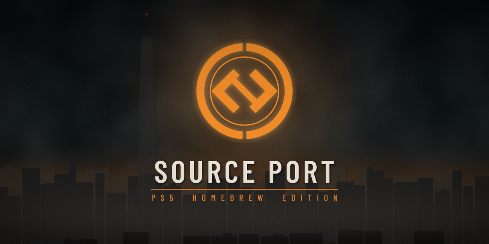
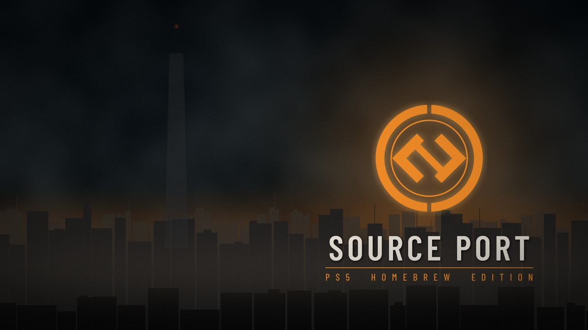
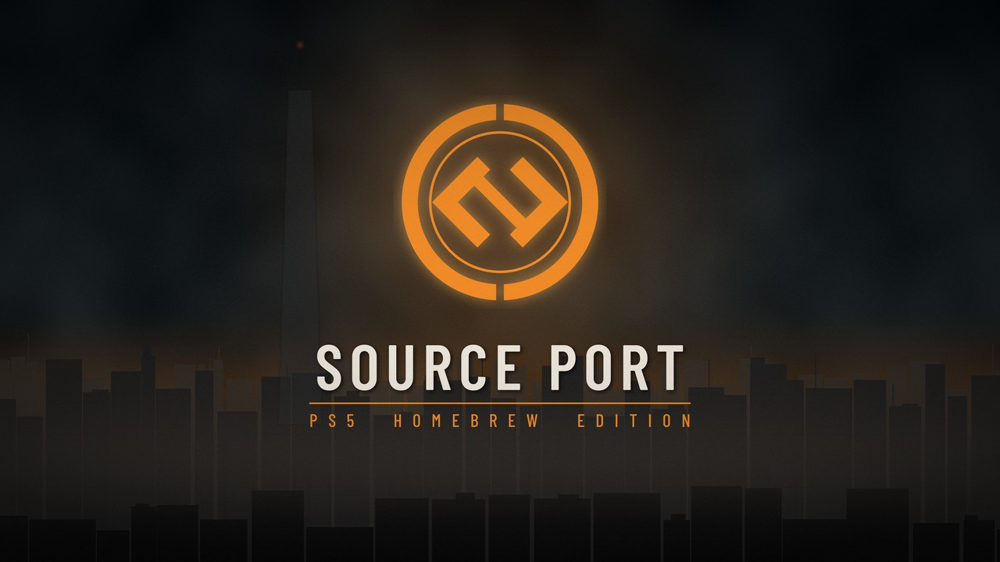
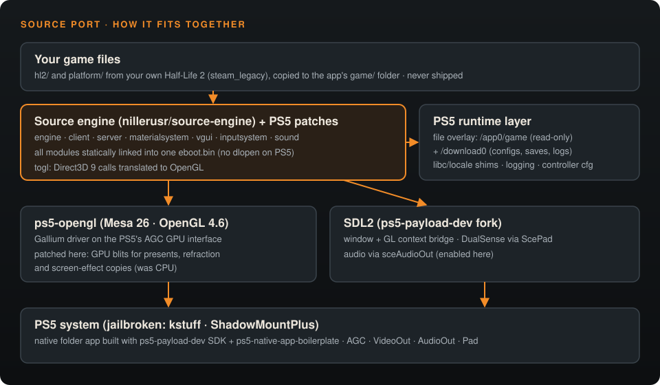

<p align="center">
  
</p>

<p align="center">
  
  
  
</p>

<p align="center">
  <b>A native PlayStation 5 port of the Source engine.</b><br>
  Runs <i>Half-Life 2</i> on a jailbroken PS5 from your own game files, with GPU rendering,
  sound, DualSense controls and saves.
</p>

---

## Contents

- [Highlights](#highlights)
- [Home screen](#home-screen)
- [Requirements](#requirements)
- [Install](#install)
- [Controls](#controls)
- [Configuration](#configuration)
- [Known issues](#known-issues)
- [How it works](#how-it-works)
- [Building from source](#building-from-source)
- [Roadmap](#roadmap)
- [Credits and licenses](#credits-and-licenses)

## Highlights

- **Native PS5 app.** Not an emulator or a Wine layer: the engine is compiled
  for the console and installed as its own title with its own icon, background and music.
- **Half-Life 2's opening chapters play** at typically 50–60 fps at 1920×1080:
  maps load, scripted scenes run and saves work.
- **GPU-accelerated:** OpenGL 4.6 through Mesa, with present, refraction and
  screen-effect copies moved from the CPU to the GPU.
- **Sound** through the PS5's audio output.
- **DualSense** support with a ready-made layout (sprint toggle, gravity-gun
  swap, squad commands, quicksave on the touchpad).
- **Your files stay yours.** No Valve content is included. You copy your
  own `hl2` and `platform` folders to the console.

## Home screen

<table>
  <tr>
    <td align="center" width="25%"><br><sub>App icon</sub></td>
    <td align="center"><br><sub>Home-screen background, with original dark-ambient selection music</sub></td>
  </tr>
  <tr>
    <td colspan="2" align="center"><br><sub>Launch screen</sub></td>
  </tr>
</table>

## Requirements

| What | Details |
| --- | --- |
| **Console** | A jailbroken PS5 that can run native homebrew titles. Developed and tested on firmware **7.60** with **kstuff**, **elfldr** and **ShadowMountPlus**. Other firmwares that run native homebrew titles should work, but are untested. |
| **Loader** | [ShadowMountPlus](https://github.com/drakmor/ShadowMountPlus) (registers folders in `/data/homebrew` as titles) |
| **Transfer** | An FTP server or a file manager on the console |
| **Game files** | Your own copy of **Half-Life 2** on Steam, switched to the **`steam_legacy`** beta (the pre-20th-anniversary build) |

> **Why `steam_legacy`?** The 2024 anniversary update changed the shader files,
> so this engine (2013-era code) draws a black menu with them. The legacy branch
> matches.

## Install

1. **Download** `PPSA20040.zip` from the [latest release](../../releases/latest) and unzip it.
   You get a folder named `PPSA20040`.
2. **Get the game files.** In Steam, right-click Half-Life 2, then
   *Properties → Betas* and choose **steam_legacy**. Wait for the download.
3. **Assemble the app folder** on your PC:
   ```
   PPSA20040/
   ├── eboot.bin
   ├── sce_module/
   ├── sce_sys/
   ├── assets/
   └── game/                 ← create this folder
       ├── hl2/              ← from steamapps/common/Half-Life 2/hl2
       └── platform/         ← from steamapps/common/Half-Life 2/platform
   ```
   Only `hl2` and `platform` are needed; skip `bin` and the `.exe` files.
4. **Copy** the whole `PPSA20040` folder to `/data/homebrew/` on the PS5.
5. **Register it.** Start (or restart) ShadowMountPlus and wait for
   **Source Port (alpha)** to appear on the home screen.
6. **Launch it.** The first start takes a little longer while the engine builds its caches.

> **Updating:** replace `eboot.bin`, `sce_module/`, `sce_sys/` and `assets/`
> and keep your `game/` folder. Settings and saves are stored in the app's own
> console data (`/download0`), so they survive updates.

## Controls

| Button | Action | Button | Action |
| --- | --- | --- | --- |
| Left stick | Move | Right stick | Look |
| **R2** | Fire | **L2** | Secondary fire |
| **R1** | Next weapon | **L1** | Previous weapon |
| **✕ Cross** | Jump | **◯ Circle** | Crouch on/off |
| **▢ Square** | Reload | **△ Triangle** | Use / pick up |
| **L3** | Sprint on/off (after you get the HEV suit) | **R3** | Zoom (hold) |
| **D-pad ↑** | Flashlight | **D-pad ↓** | Last weapon |
| **D-pad ←** | Gravity-gun swap | **D-pad →** | Squad command |
| **Touchpad click** | Quicksave | **Options** | Pause menu |

The layout is written to `hl2/cfg/360controller.cfg` in the app's data on
every start. Menus also work with the D-pad and ✕.

## Configuration

The command line can be changed without rebuilding. Create
`PPSA20040/game/args.txt` with a single line. The default is:

```
-game hl2 -w 1920 -h 1080 -fullscreen -novid
```

Useful additions:

| Option | Effect |
| --- | --- |
| `+map d1_trainstation_01` | Start straight into a map |
| `-nosound` | Disable audio |
| `-console -dev 2 -condebug` | Open the developer console and write `console.log` |
| `-ps5_prof` | Built-in sampling profiler, written to the log every 30 s (development) |
| `-ps5_quit1` … `-ps5_quit4` | Alternative ways of quitting the app (see [Known issues](#known-issues)) |

**Logs** are mirrored to the kernel log, readable with the
[klogsrv](https://github.com/ps5-payload-dev) payload on port 3232. They are also
written to `zmr.log` in the app's data. Attach a log to bug reports.

## Known issues

- **Quitting shows a system error** before returning to the home screen.
  Nothing is lost: settings and saves are written before the engine exits. The
  `-ps5_quit1`…`4` options try other exit methods; reports welcome.
- **Short hitches the first time an area loads** while shaders are compiled and
  textures are uploaded. They are gone on the next pass.
- **Only Half-Life 2 has been tested.** Episodes, Lost Coast and mods are not
  supported in this alpha.
- **No online multiplayer.** There is no Steam on the console.
- **The anniversary-update game files don't work** (black menu). Use `steam_legacy`.

## How it works

<p align="center"></p>

- **Engine:** [nillerusr/source-engine](https://github.com/nillerusr/source-engine),
  with PS5 patches (`patches/source-engine-ps5.patch`). The PS5 has no `dlopen` for
  homebrew, so every engine module is compiled as a static archive. The modules'
  symbols are then isolated, and everything is linked into **one `eboot.bin`**
  (`ps5/staticlink.py`).
- **Graphics:** the engine's Direct3D-to-OpenGL layer (togl) runs on
  **ps5-opengl** (Mesa 26.2, OpenGL 4.6 on the PS5's AGC interface). This port
  patches the driver so full-screen copies (presenting frames, refraction,
  screen effects) run on the GPU instead of the CPU, which took gameplay from
  about 3 fps to about 60 (`patches/ps5-opengl-local.patch`).
- **Platform:** the SDL2 fork from ps5-payload-dev provides the window, DualSense
  input and (enabled here) audio. A small runtime layer (`ps5/runtime/`)
  handles the read-only app folder with a writable overlay, libc gaps, logging
  and diagnostics.

## Building from source

See **[docs/BUILDING.md](docs/BUILDING.md)**. In short, on Linux (x86-64) you
check out the upstream projects at the listed revisions, apply the two patches,
build the ps5-opengl SDK and SDL bridge, and then run:

```bash
ps5/build-all.sh     # engine → static modules → PPSA20040 app folder
```

## Roadmap

- [ ] Clean exit to the home screen
- [ ] Zombie Master: Reborn (the project's original goal)
- [ ] Half-Life 2 episodes and Source mods
- [ ] Shader cache to remove first-load hitches
- [ ] Vulkan path (via the PS5 RADV driver)

## Credits and licenses

This port is built on the work of others:

- [nillerusr/source-engine](https://github.com/nillerusr/source-engine): the Source engine fork this port compiles.
- [ps5-opengl](https://github.com/Marice/ps5-opengl) (BlackBearReloaded): OpenGL 4.6 for PS5 homebrew, built on [PS5_Mesa](https://github.com/mihawk-99/PS5_Mesa).
- [ps5-payload-dev](https://github.com/ps5-payload-dev): the PS5 SDK and the SDL2 port.
- [ps5-native-app-boilerplate](https://github.com/mpereiraesaa/ps5-native-app-boilerplate): native title packaging.
- PacBrew: PS5 builds of freetype, zlib, libpng, OpenAL and others.
- [Barlow Condensed](https://github.com/google/fonts/tree/main/ofl/barlowcondensed) (SIL OFL 1.1), used in the logo.

The build scripts, runtime, patches and artwork in this repository are released
under the **GNU GPL v3.0** (see [LICENSE](LICENSE)), the license of the
ps5-opengl and template code they link against. Third-party notices are in
[THIRD_PARTY.md](THIRD_PARTY.md).

> **Disclaimer.** This is an unofficial fan project, not affiliated with or
> endorsed by Valve Corporation or Sony Interactive Entertainment. *Half-Life*,
> *Source* and *Steam* are trademarks of Valve; *PlayStation* and *PS5* are
> trademarks of Sony Interactive Entertainment. No game content is distributed;
> you need your own legally purchased copy. The engine code comes from the
> community source-engine project, whose code is not distributed under an
> open-source license from Valve.
